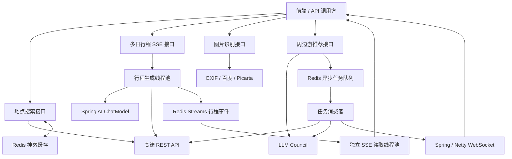

# GaoDeMCPTest · 智能旅游规划后端

GaoDeMCPTest 是一个基于 Java 17 和 Spring Boot 的旅游规划后端，结合高德地图的地点、天气与路径数据，以及兼容 OpenAI 协议的大模型服务，为前端提供地点搜索、多日行程生成、图片位置识别和周边游推荐能力。

项目围绕两种交互方式展开：多日行程通过 SSE 逐步返回景点与路线，周边游推荐可以提交为异步任务，再通过 WebSocket 接收结果。Redis 同时承担搜索缓存、行程事件保存、推荐任务队列与任务状态存储。

本仓库提供后端接口与数据，不包含完整地图前端。虽然项目名称包含 MCP，目前 MCP 配置及相关依赖处于注释状态，运行中的核心能力通过 HTTP、SSE 和 WebSocket 暴露。

## 主要能力

| 能力 | 实现方式 | 使用场景 |
| --- | --- | --- |
| 地点搜索 | 高德 POI 搜索，支持关键词、城市、类型与分页；Redis 缓存与热门词统计 | 目的地选择、搜索建议 |
| 多日行程规划 | Spring AI 调用大模型，结合高德 POI、天气和路径数据，逐步输出每日景点与路线 | 城市旅行计划、地图行程展示 |
| 行程事件续传 | SSE 事件写入 Redis Streams，按任务 ID 和事件 ID 读取 | 页面刷新、网络中断后的结果恢复 |
| 图片位置识别 | 尝试读取 EXIF GPS，再使用百度地标识别与 Picarta 定位作为后续识别途径 | 从旅行照片寻找地点 |
| 周边游推荐 | 获取附近景点，交由 LLM Council 生成与评审推荐 | 根据坐标或地标规划周边游 |
| 异步推荐 | Redis List 排队、状态机管理、超时扫描、WebSocket 推送 | 避免同步等待多轮模型调用 |

高德数据为生成过程提供地点与路线依据，但模型生成内容仍需业务侧校验，不能将推荐结果视为实时营业信息或确定可行的旅行承诺。

## 业务链路



### 多日行程：生成与连接分离

`TripPlanServiceImpl` 在后台生成行程，把天气、景点、路线及终止事件写入 Redis；连接侧从 Redis Streams 读取事件并发送给客户端。生成线程不直接写入客户端连接，慢连接和断线不会持续占用生成线程进行网络输出。

任务设有总时限和模型输出空闲超时。超时或上游异常会结束生成、释放流订阅，并输出错误事件；不会把失败任务标记为成功完成。连接断开后，已启动的生成可以在时限内继续，客户端可在事件保留期内重连。

### 周边游推荐：多轮模型协作

`LocationLlmCouncil` 采用“候选回答 → 匿名评审排序 → 主席综合”的流程。模型列表可配置，允许不同模型参与，也允许同一模型多次参与。多轮调用意味着该链路的耗时与费用通常高于一次模型请求。

异步推荐通过 Redis List 入队，由消费者生成推荐并向订阅该任务的 WebSocket 连接推送结果。任务状态机包含 `CREATED`、`QUEUED`、`RUNNING`、`PUSHING`、`DONE`、`ERROR`、`EXPIRED`。超时队列还包含处理中事件回收与重试机制；这些重试针对超时事件处理，不代表完整 AI 任务会自动重跑。

## 技术栈

| 组件 | 当前版本或用途 |
| --- | --- |
| Java | 17 |
| Spring Boot | 3.2.4 |
| Spring Cloud Alibaba | 2023.0.1.0；Nacos 配置与服务发现 |
| Spring AI | 1.0.0-M6；OpenAI 兼容协议模型调用 |
| Spring Web MVC | REST 与 `SseEmitter` |
| Spring Data Redis | 缓存、Streams、List、任务状态与超时队列 |
| Spring WebSocket / Netty | 两种 WebSocket 接入；Netty 声明版本 4.1.109.Final |
| Apache HttpClient | 高德等第三方 HTTP 调用 |
| Jackson / metadata-extractor | JSON 处理与图片 EXIF 读取 |
| Spring Boot Actuator | 健康检查等运行状态接口 |

## 本地运行

### 1. 准备环境

- JDK 17、Maven，以及可以访问的 Redis。
- 高德 Web 服务 API Key。
- 支持聊天与流式输出的 OpenAI 兼容模型服务。
- 使用图片识别时，还需配置百度与 Picarta；使用周边游推荐时，需要配置 LLM Council。

当前部分组件使用必填 `@Value` 配置，即使暂时不调用图片接口，也需要保留相关配置项。仓库中的配置应按自己的环境替换，密钥通过环境变量或配置中心注入，不要将真实密钥写进提交记录。

### 2. 配置服务

配置入口为 `src/main/resources/application.yml` 和 `src/main/resources/bootstrap.yaml`。下面是配置结构示例，模型名必须替换为供应商实际支持的名称：

```yaml
server:
  port: 8082
spring:
  application:
    name: GaoDeMCPTest
  data:
    redis:
      host: localhost
      port: 6379
      database: 0
      password: ${REDIS_PASSWORD:}
  ai:
    openai:
      api-key: ${TRIP_AI_API_KEY}
      base-url: ${TRIP_AI_BASE_URL}
      chat:
        options:
          model: ${TRIP_AI_MODEL}
  servlet:
    multipart:
      max-file-size: 10MB
      max-request-size: 10MB
amap:
  rest:
    key: ${AMAP_REST_KEY}
baidu:
  ai:
    api-key: ${BAIDU_API_KEY:}
    secret-key: ${BAIDU_SECRET_KEY:}
  image:
    api-key: ${BAIDU_IMAGE_API_KEY:}
    secret-key: ${BAIDU_IMAGE_SECRET_KEY:}
picarta:
  api:
    token: ${PICARTA_TOKEN:}
llm:
  council:
    api-key: ${COUNCIL_API_KEY:}
    api-url: ${COUNCIL_API_URL:https://openrouter.ai/api/v1/chat/completions}
    models: ${COUNCIL_MODELS:moonshotai/kimi-k2.5}
    chairman-model: ${COUNCIL_CHAIRMAN_MODEL:moonshotai/kimi-k2.5}
```

**两套模型配置彼此独立：**

| 配置前缀 | 使用方 | URL 含义 |
| --- | --- | --- |
| `spring.ai.openai` | `/api/trip/stream-plan` 多日行程 | `base-url` 是服务基础地址，由 Spring AI 拼接聊天接口路径 |
| `llm.council` | 图片模块的周边游推荐及异步推荐 | `api-url` 是完整聊天接口 URL，通常以 `/chat/completions` 结尾 |

仅修改 `llm.council.models` 不会改变多日行程使用的模型。当前 Spring AI 版本未显式配置模型时默认使用 `gpt-4o-mini`；建议始终显式设置 `spring.ai.openai.chat.options.model`，避免默认模型与供应商能力不匹配。

### 3. 选择配置模式

**使用 Nacos：** 仓库默认启用 `dev` profile，配置分组为 `TRIP_GROUP`，对应 YAML Data ID 为 `GaoDeMCPTest-dev.yml`。按环境配置 Nacos 地址与 namespace，启动时检查日志确认实际加载的数据源。namespace 使用命名空间 ID；环境变量可以覆盖本地配置，空 namespace 对应 public。服务发现分组与配置分组是两个独立设置。

**独立运行：** 将上述配置保存为 `config/application.yml`，准备相应环境变量，并在启动命令中关闭 Nacos 配置、发现和自动注册。不要依赖仓库中的远程配置地址作为自己的运行环境。

```bash
mvn clean package -DskipTests

java -jar target/GaoDeMCPTest-0.0.1-SNAPSHOT.jar \
  --spring.config.additional-location=optional:file:./config/ \
  --spring.cloud.nacos.config.enabled=false \
  --spring.cloud.nacos.discovery.enabled=false \
  --spring.cloud.service-registry.auto-registration.enabled=false
```

以上为 Bash 示例；PowerShell 可将启动参数写在同一行。默认 HTTP 端口为 `8082`，独立 Netty WebSocket 端口为 `8090`，需确保两者未被占用。

配置中心变更不等于所有已创建的客户端立即更新。当前相关组件没有统一的动态刷新机制，修改模型、URL 或密钥后应重启服务，并用真实请求验证生效情况。

## HTTP 接口

以下为本服务直接提供的路径。经过外部网关时，认证与路由规则由网关决定。

| 方法 | 路径 | 请求内容 | 返回方式 |
| --- | --- | --- | --- |
| GET | `/api/search/suggest` | `keyword`，可选 `city`、`types`、`page`、`size` | 分页地点数据 |
| POST | `/api/trip/stream-plan` | JSON 地点；可选 `days`、`preference`、`taskId` | SSE 多日行程 |
| POST | `/api/image/identify-location` | multipart 字段 `file` | 图片位置识别结果 |
| POST | `/api/image/identify-location-with-effects` | multipart 字段 `file` | SSE 识别过程与结果 |
| POST | `/api/image/travel-plan` | 请求参数 `lng`、`lat`，可选 `landmarkName` | 同步周边游推荐 |
| POST | `/api/image/async-travel-plan` | 请求参数 `lng`、`lat`，可选 `landmarkName` | 异步推荐任务 ID |

搜索默认 `page=1`、`size=10`，单页大小最多 50。当前搜索实现缓存分页请求对应的 POI 列表，空结果短期缓存；返回的 `total` 按当前列表长度计算，不应作为高德全部匹配结果的总数使用。

```bash
curl "http://localhost:8082/api/search/suggest?keyword=park&city=杭州&page=1&size=10"

curl -N -X POST "http://localhost:8082/api/trip/stream-plan?days=3" \
  -H "Content-Type: application/json" \
  -d '{"city":"杭州","title":"西湖","lng":120.15,"lat":30.25}'

curl -X POST "http://localhost:8082/api/image/identify-location" \
  -F "file=@travel-photo.jpg"

curl -X POST "http://localhost:8082/api/image/async-travel-plan" \
  --data-urlencode "lng=120.15" --data-urlencode "lat=30.25" \
  --data-urlencode "landmarkName=西湖"
```

Windows PowerShell 使用 `curl.exe`，避免旧版 PowerShell 的 `curl` 别名影响调用。

## SSE 事件与断线续传

多日行程接口要求有效的城市与经纬度。`days` 默认 3，控制器将值限制在 1–10；`preference` 可传旅行偏好。该接口是 **POST + JSON 请求体**，浏览器原生 `EventSource` 无法直接调用，应使用 `fetch` 流式读取或支持 POST SSE 的客户端。

| 事件 | 含义 | 数据概要 |
| --- | --- | --- |
| `trip-meta` | 任务信息 | `{ "taskId": "..." }` |
| `trip-weather` | 天气数据 | 城市与天气信息 |
| `trip-data` | 行程增量 | 包含 `day`、`color`，以及 `spot` 或 `route` 等字段 |
| `trip-done` | 生成成功结束 | 完成标记，JSON 解析后为字符串 `[DONE]` |
| `trip-error` | 生成失败或超时 | 错误信息 |

客户端应按 SSE 规范解析 `event`、`id` 和 `data`，以空行作为事件边界，不能将一次网络读取等同于一个完整事件。保存 `trip-meta` 中的任务 ID，以及最后成功处理的事件 ID。

断线后，重新发送相同的 POST 请求体，在查询参数中提供原 `taskId`，并通过 `Last-Event-ID` 请求头提供最后处理的 ID：

```bash
curl -N -X POST "http://localhost:8082/api/trip/stream-plan?days=3&taskId=YOUR_TASK_ID" \
  -H "Content-Type: application/json" \
  -H "Last-Event-ID: YOUR_LAST_EVENT_ID" \
  -d '{"city":"杭州","title":"西湖","lng":120.15,"lat":30.25}'
```

事件 ID 是 Redis Stream ID，应原样保存。续传读取该 ID 之后的事件；没有游标时可读取保留的历史事件。客户端收到 `trip-done` 或 `trip-error` 后即可结束业务等待，不必等待底层 HTTP 连接关闭。

事件默认保留 300 秒，并在追加时刷新过期时间。续传依赖 Redis 中仍存在任务数据；超出保留期后应作为新任务重新提交。正在生成的任务协调状态仍位于应用内存，当前不保证进程重启后继续生成，也不提供跨实例的全局任务去重或严格 exactly-once 语义。

## WebSocket 推荐结果

异步周边游推荐使用以下任一地址订阅任务：

```text
ws://localhost:8082/ws/travel-plan?taskId=YOUR_TASK_ID
ws://localhost:8090/ws/travel-plan?taskId=YOUR_TASK_ID
```

前者由 Spring WebSocket 提供，后者由独立 Netty 服务提供；两者使用同一个推荐结果发送组件。

成功消息包含 `taskId`、`success: true`、`type: "travel-plan"` 和 `data`；失败消息包含 `taskId`、`success: false`、`type: "error"` 和 `message`。

WebSocket 推送与行程 SSE 的 Redis 事件回放是不同机制。当前 WebSocket 结果推送依赖在线连接，不能假定断线后会自动补发历史结果；客户端应尽快订阅返回的任务 ID，并处理连接失败或结果未收到的情况。

## 超时、并发与部署

| 参数或资源 | 默认值 | 作用 |
| --- | --- | --- |
| `trip.plan.max-duration-seconds` | 120 | 行程生成总时限，包含排队等待 |
| `trip.plan.ai-idle-timeout-seconds` | 45 | 模型流持续无输出的等待上限 |
| SSE 连接生命周期 | 180 秒 | 单次行程 SSE 连接上限 |
| `trip.sse.stream.retention-seconds` | 300 | Redis 行程事件与状态保留时间 |
| `trip.sse.stream.read-batch-size` | 100 | 单次事件读取数量 |
| `trip.sse.stream.block-seconds` | 5 | Redis 流阻塞读取时间 |
| 行程生成线程池 | 核心 4 / 最大 8 / 队列 100 | 限制后台生成并发 |
| SSE 读取线程池 | 8 / 队列 32 | 将连接读取与生成隔离 |
| 行程相关高德 HTTP 调用 | 连接及连接池等待 5 秒 / 读取 10 秒 | 限制外部 HTTP 阻塞 |

并发资源耗尽时可能返回 HTTP 503，客户端应退避重试。调整时限应同时考虑模型首包时间、任务排队、第三方请求和网关超时；单纯增大超时不会提高模型生成速度。

部署时需配置 Redis、模型与高德服务的网络访问，按需开放 HTTP 和 Netty 端口。使用反向代理时，SSE 路由需要关闭响应缓冲，读取超时应覆盖连接生命周期；WebSocket 路由需要转发 Upgrade/Connection 头。网关认证失败应先排查 token 和路由，再判断生成服务是否异常。

可使用 `/actuator/health` 检查应用健康状态，但健康检查成功只说明服务及已启用的健康项正常，不能替代一次实际的模型流式请求。排查慢请求时，应区分排队、模型首包、模型生成、高德请求和代理缓冲等阶段。

## 代码组织与验证

```text
src/main/java/com/zhh/handsome/gaodemcptest/
├── controller/    搜索、行程与图片 HTTP 接口
├── service/       业务实现及 Redis Streams SSE 存储
├── model/         数据模型、高德 POI 工具与 LLM Council
├── async/         推荐任务队列、状态机与超时扫描
├── websocket/    Spring / Netty 接入与结果推送
├── config/        Redis、线程池、Web 与 WebSocket 配置
└── util/          图片定位及第三方 API 工具
src/main/resources/        application.yml 与 bootstrap.yaml
src/test/java/             行程生命周期与 SSE 存储回归测试
```

运行本次行程稳定性修复涉及的回归测试：

```bash
mvn -Dtest=TripPlanServiceLifecycleTest,TripPlanStreamableSseStoreTest test
```

测试覆盖超时、流订阅释放、错误终止、任务提交与 SSE 存储读取等关键行为。测试通过后，仍需在自己的 Redis、模型服务及代理环境中验证首次生成与断线续传。

相关设计与接口资料：

- [行程服务说明](TRIP_PLAN_SERVICE_DOC.md)
- [Redis 延迟队列设计](Redis_Delay_Queue_Design.md)
- [WebSocket 改进说明](WebSocket_Improvements.md)
- [接口导出](apifox-openapi.json)
- [图片位置接口导出](image-location-openapi.json)

历史文档和接口导出可能尚未同步最新实现，接口方法、参数和运行行为以当前控制器、服务代码及本文说明为准。
